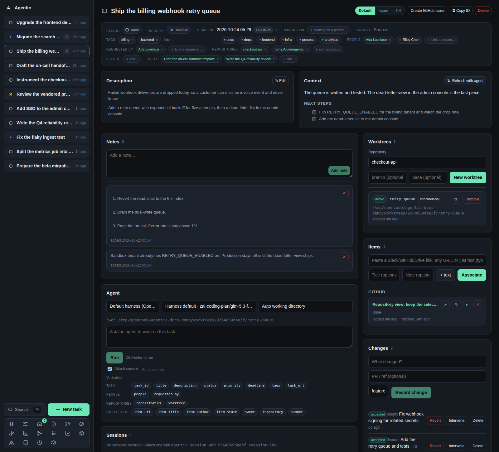
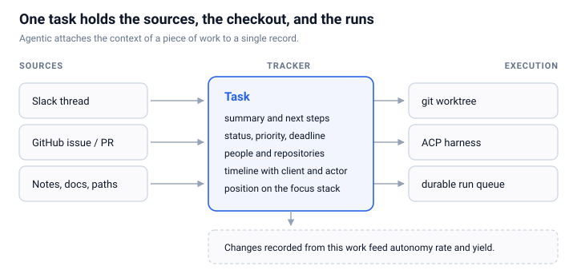

# Promotion Plan: Agentic: a work tracker for coding agents

## Article fingerprint

- Summary: Agentic is a local-first work tracker that keeps each task's sources, worktree, runs, and an agent-maintained summary in one place, so resuming delegated work costs a read instead of a context rebuild.
- Takeaways:
  - The slow part of working with coding agents is rebuilding context, not waiting for the code.
  - A task that holds its Slack threads, issues, people, worktrees, and runs makes resuming cheap.
  - The CLI and API let an agent maintain the tracker itself.
  - Any ACP harness fits behind one durable run queue.
  - Autonomy rate and yield measure how much work the agent finished without a person.
  - Local-first removes OAuth and sync work, and costs authentication and multi-user support.
- Tags: ai, agents, developer-tools, local-first, work-tracking, cli, agent-client-protocol, software-engineering, productivity

## Hacker News

- Status: draft (HN has no submit API; automating submission violates its terms)
- Title: Show HN: Agentic, a local-first work tracker for coding agents
- Article URL: https://blog.tomrochette.com/agentic/
- Submit: https://news.ycombinator.com/submit

Suggested first comment from the author:

> I built this because the work I hand to coding agents kept living in five places, and every new session started by re-reading them. Agentic keeps a task, its sources, its worktree, and its runs together, and a context run writes the summary and next steps back to the task.
>
> It is single-user and local-first on purpose: SQLite on your machine, no auth, no hosted service. That also means it is only safe on a trusted network. The harness side is ACP, so OpenCode and pi work today and another harness is a Settings row.
>
> Happy to answer questions about the queue design, the ACP wiring, or the metrics.

## Lobsters

- Status: draft (invite-only, per-user API key)
- Title: Agentic: a local-first work tracker for coding agents
- URL: https://blog.tomrochette.com/agentic/
- Tags: ai, programming, tools
- Submit: https://lobste.rs/stories/new

Body for the description field:

> A tracker for one developer working with coding agents. Tasks hold their sources (Slack, GitHub, Drive, URLs, notes, paths), a git worktree, agent runs, and an agent-written summary and next-steps list. Harnesses connect over ACP, runs go through a durable SQLite queue, and recorded changes produce an autonomy rate and a yield. Local-first, single-user, no authentication.

## Reddit

Check each subreddit's self-promotion rules and account-age requirements before posting.

### r/programming

- Status: draft
- Title: I built a local-first work tracker because my coding agent forgets the work between sessions
- Submit: https://www.reddit.com/r/programming/submit?title=I%20built%20a%20local-first%20work%20tracker%20because%20my%20coding%20agent%20forgets%20the%20work%20between%20sessions&url=https%3A//blog.tomrochette.com/agentic/

### r/ExperiencedDevs

- Status: draft
- Title: I built a local-first work tracker because my coding agent forgets the work between sessions
- Submit: https://www.reddit.com/r/ExperiencedDevs/submit?title=I%20built%20a%20local-first%20work%20tracker%20because%20my%20coding%20agent%20forgets%20the%20work%20between%20sessions&url=https%3A//blog.tomrochette.com/agentic/

## Dev.to

- Status: draft (no `DEV_TO_API_KEY` set)
- Title: Agentic: a work tracker for coding agents
- Tags: ai, productivity, opensource, programming
- Publish with `published: false`, review formatting, then publish.
- Canonical line to prepend:

```markdown
Canonical URL: https://blog.tomrochette.com/agentic/
<!-- {original first published at https://blog.tomrochette.com/agentic/} -->
```

Full body to paste after the canonical line:

````markdown
Most of my work now starts with an agent, and most of the time goes to telling the agent what the work is.
The issue sits in one tab, the Slack thread in another, the checkout in a third, and the last session's conclusions exist only in that session's transcript.
**The slow part of delegation is not the agent writing code, it is rebuilding the context around the work each time I return to it.**
[Agentic](https://github.com/TomzxCode/agentic) is the tool I built to remove that cost: a local-first work tracker where a task holds its sources, its checkout, its agent runs, and a summary the agent refreshes on demand.

## The agent does not remember the work for you

A coding agent is fast inside one session and forgets the work when the session ends.
It can read a repository, run the tests, and produce a patch in minutes.
It cannot tell you why the task exists, who is waiting on it, what was already tried, or which of the five open branches is the one that matters.

That context lives in the systems around the agent, and for a single developer those systems are held together by memory.
I kept writing one-off tools to fetch an issue, to open a worktree, and to remind myself what a branch was for.
Each tool solved its problem and then sat unused, because the cost of remembering to run it was higher than the cost of re-reading the source.
Agentic is the consolidation of those tools into one record that all of them feed.

## A task is the unit, and everything attaches to it

Agentic starts from one record, the task.
A task carries a description, a status, a priority, tags, a deadline, and a timeline of every meaningful change made to it.
Everything else attaches to that record.

- **Items** are the external sources of the work: a Slack thread, a GitHub issue or pull request, a Drive document, a URL, a note, a commit, or a local file or directory path.
- **People** are the people involved, kept in a directory and linked to tasks and items.
  A fetched GitHub issue brings its author, assignees, and commenters, and a Slack thread brings its participants.
- **Repositories** are registered checkouts.
  A task can span several, and a repository group tells the agent which checkouts may hold information about it.
- **Worktrees** are isolated [git worktrees](https://git-scm.com/docs/git-worktree) created for one task from one repository.
- **Runs and sessions** are the work handed to an agent.
  A run is one prompt sent in a working directory, and a session is the agent session recorded against the task, with links to reopen it in a terminal or in [OpenChamber](https://github.com/openchamber/openchamber), a session UI for OpenCode.
  A session you started elsewhere can also be attached to a task by hand.

The reason to keep all of them on one record is that each one is something I would otherwise re-read before starting work.

Pasting a URL is enough to create an item, because the app infers the source from the link.
GitHub items are read through [ghx](https://github.com/TomzxCode/ghx) and Slack threads through [slackx](https://github.com/TomzxCode/slackx), two local tools I built for the same workflow.
A path stays a reference to the file on disk, read live when opened and never copied into the database.

The payoff is that resuming a task costs a read.
You open one page and see the issue, the discussion, the people, the branch, what the agent concluded, and what you decided to do next.



The app also keeps a focus stack, an ordered queue of the work in flight with the current task on top.
Every open, in progress, or blocked task joins the stack automatically, so the queue never needs manual maintenance.
A task that waits on a person, or is snoozed until a date, leaves the stack and returns when the date passes.

## The agent maintains its own context

The feature that changed how I use the tool is **Refresh with agent**.
It runs an agent against the task and its linked items and asks it to write two fields: a summary of where the work stands and a list of next steps.
Those fields live on the task, not in a transcript, so the next session starts from a prepared summary instead of a blank prompt.

That only works because the agent can read and write the tracker.
The `agentic` CLI is a client for the same HTTP API the web app uses, with JSON output by default when piped.
It covers tasks, items, worktrees, runs, and sessions, so an agent can create a task from an issue, link a source, move a status, read the stack, or stream a run without a browser.

```bash
agentic task create --github-url https://github.com/owner/repository/issues/42
agentic run create <task> --prompt "Investigate the failure"
agentic run stream <run-id>
```

The CLI and API also record provenance.
Every timeline event carries the client it came from (web, CLI, or API) and whether a person or an agent did it, and every mutating request lands in an operations log.
When a task changes at 3 a.m., the record says whether a person or an agent changed it and through which interface.

## Any harness, one durable queue

Agentic does not embed an agent.
It speaks the [Agent Client Protocol](https://agentclientprotocol.com/) over stdio, so each harness is a command in a database table rather than code in the app.
OpenCode and pi are seeded on first start, and another ACP-speaking harness can be added in Settings.

A run is a job on a [SAQ](https://github.com/tobymao/saq) queue backed by SQLite.
The API only enqueues, and a separate worker process dequeues, spawns the harness in the task's worktree, and streams normalized events back over server-sent events (SSE).
Separating the API from the worker matters in practice.
A long agent turn survives an API restart, a failed run can be retried, and workers scale independently of the web server.



You pick the harness and the model in the run panel, and the choice applies to that run only.
A task can keep its default harness and answer a single question with a different model.

## Measure how much the agents did alone

Delegation is only useful if you know what came back without you.
Agentic records a change against a task: a class, a status (proposed, verified, accepted, rejected, or reverted), a start and end time, and whether a person intervened.
Interventions are recorded by hand, so the autonomy rate depends on remembering to record them.

From those records the Metrics page computes two numbers:

- **Autonomy rate** is the share of accepted changes that had no human intervention.
- **Yield** is the share of accepted changes that survived their observation window (14 days by default) without a revert.

Both are shown against a stored baseline, so the question changes from "did the agent help today" to "is the share of work it finishes alone improving".
Recording is automatic for the common case: when the app sees one of your pull requests merge and a task links that pull request, it records an accepted change.

I wrote about why I want these numbers in [Metrics for a Software Factory: Optimize Autonomy, Guard the Trust](../metrics-for-a-software-factory/_index.md).
A number you can watch weekly is easier to improve than a feeling about how the week went.

## Local-first, with the cost stated

Agentic runs on your machine.
The database is SQLite under `~/.agentic`, worktrees are created under a configurable worktree root (`~/.agentic/worktrees` by default), and there is no server to sign up for.
Running locally removes a lot of work.
There are no OAuth flows, no continuous two-way sync, no tenancy model, and no network round trip to read your own task list.

The cost is explicit.
There is no authentication and no multi-user isolation, so anyone who can reach the port can read and change everything and start agent runs.
Run it on a trusted network, or over a private VPN such as Tailscale.
It is also not a team tool: there are no shared workspaces, no permissions, and no hosted deployment.

## What it is not

Agentic is not a replacement for GitHub, CI, or code review.
It does not host repositories, run your test suite, or merge pull requests.
It is not a cloud agent dashboard.
The harness still runs the agent and the code still lives in the worktree, and Agentic is the place where the work is described, tracked, and measured.

It is also early.
The project is under active development, the schema migrates in place, and the single-user design is a choice, not a missing feature.
If you need a hosted, multi-user tracker, this is the wrong tool.

## Try it

Prerequisites are Python 3.12 or newer, [uv](https://docs.astral.sh/uv/), Node 22.12 or newer, pnpm, and at least one ACP harness on your `PATH`.

```bash
git clone https://github.com/TomzxCode/agentic.git
cd agentic
make install
make run
```

Open `http://localhost:5173`, register a repository in Settings, create a task from an issue, press **Refresh with agent**, then run an agent against it.
That loop is the product: one task, one worktree, one run, and a summary that is current the next time you open it.

If you delegate work across several repositories, track that work where the agent can read and write it, not only where you can.

The documentation starts at [tomzxcode.github.io/agentic](https://tomzxcode.github.io/agentic/), and the source is at [TomzxCode/agentic](https://github.com/TomzxCode/agentic).

## See also

- [Coordinating Multiple Agents: From Messages to a Shared Work Ledger](../coordinating-multiple-agents-from-messages-to-a-shared-work-ledger/index.md) - the shared work ledger idea that Agentic's task record implements for one developer.
- [ghx - A CLI for agentic code reviews on GitHub](../ghx/index.md) - the GitHub client Agentic reads issues and pull requests through.
- [What I've built and what I need: October 2026](../what-ive-built-and-what-i-need/2026-10/index.md) - the monthly update where consolidating one-off tools into Agentic is the headline.
- [Global Sessions: A Git Model for LLM Agent Context](../global-sessions-a-git-model-for-llm-agent-context/index.md) - the problem of carrying agent context between sessions.

## References

- [Agentic documentation](https://tomzxcode.github.io/agentic/) - the tutorial, how-to guides, view pages, reference, and explanations this article draws on.
- [Getting started tutorial](https://tomzxcode.github.io/agentic/tutorials/getting-started/) - the first task, worktree, and run, end to end.
- [How agents are wired](https://tomzxcode.github.io/agentic/explanation/how-agents-are-wired/) - the queue, the worker, and the ACP session behind a run.
- [Track changes and metrics](https://tomzxcode.github.io/agentic/how-to/track-changes-and-metrics/) - the change lifecycle behind autonomy rate and yield.
- [Why Agentic is local-first](https://tomzxcode.github.io/agentic/explanation/local-first/) - the constraints the local design implies.
- [Agent Client Protocol](https://agentclientprotocol.com/) - the protocol that lets Agentic drive any harness without app changes.
- [git worktree](https://git-scm.com/docs/git-worktree) - the isolation primitive behind a task's checkout.
- [SAQ](https://github.com/tobymao/saq) - the queue behind durable agent runs.
- [uv](https://docs.astral.sh/uv/) - the workspace and package manager the project installs with.
````

## Mastodon

- Status: draft (no `MASTODON_INSTANCE` / `MASTODON_TOKEN`)
- Text:

```text
Most of my time with coding agents goes to rebuilding the context around the work, not writing code. I built Agentic, a local-first tracker where a task holds its sources, its worktree, its runs, and an agent-maintained summary.

https://blog.tomrochette.com/agentic/ #ai #agents #devtools
```

## Bluesky

- Status: draft (no `BLUESKY_HANDLE` / `BLUESKY_APP_PASSWORD`, no `bsky` CLI verified)
- Text:

```text
Coding agents are fast inside a session and forget the work between sessions. I built Agentic: a local-first tracker where a task holds its sources, worktree, runs, and an agent-maintained summary.

https://blog.tomrochette.com/agentic/
```

## X / Twitter

- Status: draft (paid API only)
- Text: Your coding agent forgets the work between sessions. I built Agentic: a local-first tracker where each task holds its sources, worktree, runs, and an agent-maintained summary.
- Intent link: https://x.com/intent/post?text=Your%20coding%20agent%20forgets%20the%20work%20between%20sessions.%20I%20built%20Agentic%3A%20a%20local-first%20tracker%20where%20each%20task%20holds%20its%20sources%2C%20worktree%2C%20runs%2C%20and%20an%20agent-maintained%20summary.&url=https%3A//blog.tomrochette.com/agentic/

## LinkedIn

- Status: draft (personal posting API is restricted)
- Share entry point: https://www.linkedin.com/feed/?shareActive=true
- Text:

```text
Most of the work in delegating to a coding agent is not the code. It is rebuilding the context around the task: the issue, the Slack thread, the people, the checkout, and what the last session concluded.

I built Agentic to make that cost a read. Each task holds its sources, its git worktree, its agent runs, and a summary the agent refreshes on demand. The CLI and API let the agent maintain the tracker itself, and recorded changes produce an autonomy rate and a yield instead of a feeling about the week.

It is local-first and single-user by design: SQLite on your machine, no hosted service, no authentication. Run it on a trusted network.

Code and docs: https://blog.tomrochette.com/agentic/
```

## GitHub (Agentic repository)

- Status: draft (no `GH_TOKEN` in the environment)
- Audience: people already watching the Agentic repository.
- Suggested Discussion title: Agentic now has a written introduction
- Suggested body:

```markdown
I wrote an introduction to Agentic that explains the problem it solves and the design decisions behind it: local-first storage, a CLI and API agents can write to, ACP harnesses behind a durable queue, and autonomy rate and yield for measuring delegated work.

Read it: https://blog.tomrochette.com/agentic/
```

## Manual checklist

- [ ] Publish the article and confirm the canonical URL (replace `https://blog.tomrochette.com/agentic/` everywhere if the slug differs).
- [ ] HN: submit "Show HN: Agentic, a local-first work tracker for coding agents" and add the author comment.
- [ ] Lobsters: submit with the `ai`, `programming`, and `tools` tags.
- [ ] Reddit: check r/programming rules, then submit the link post.
- [ ] Reddit: check r/ExperiencedDevs rules, then submit the link post.
- [ ] Dev.to: paste the canonical line and body, review the preview, publish.
- [ ] Mastodon: post with the three hashtags.
- [ ] Bluesky: post.
- [ ] X: post with the intent link.
- [ ] LinkedIn: post the commentary plus the link.
- [ ] GitHub: open the Discussion in the Agentic repository.
